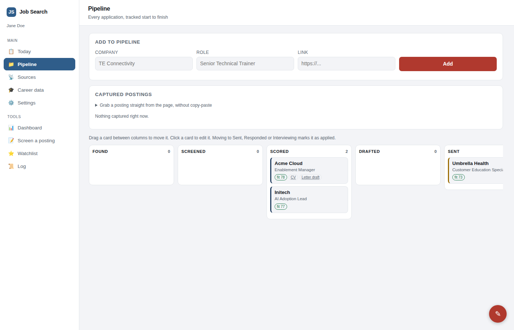
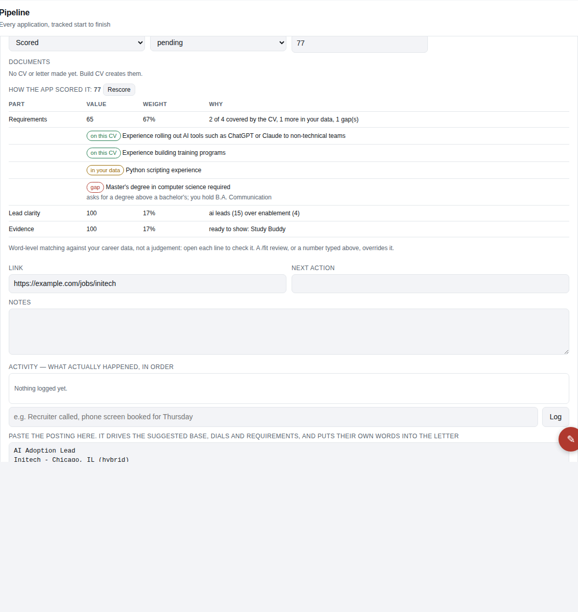
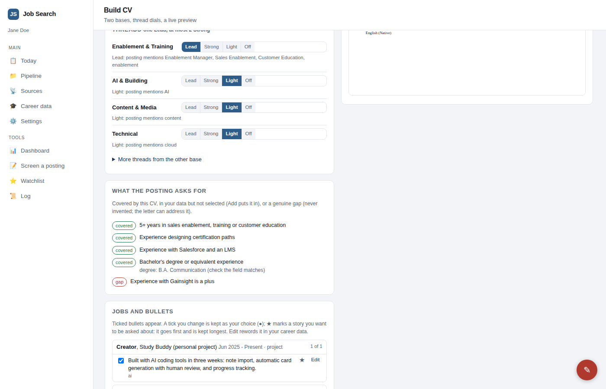
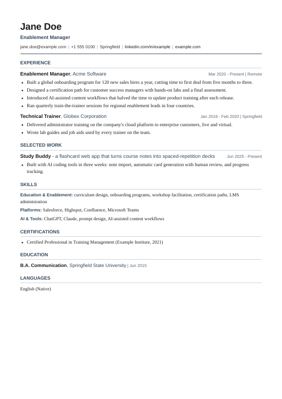
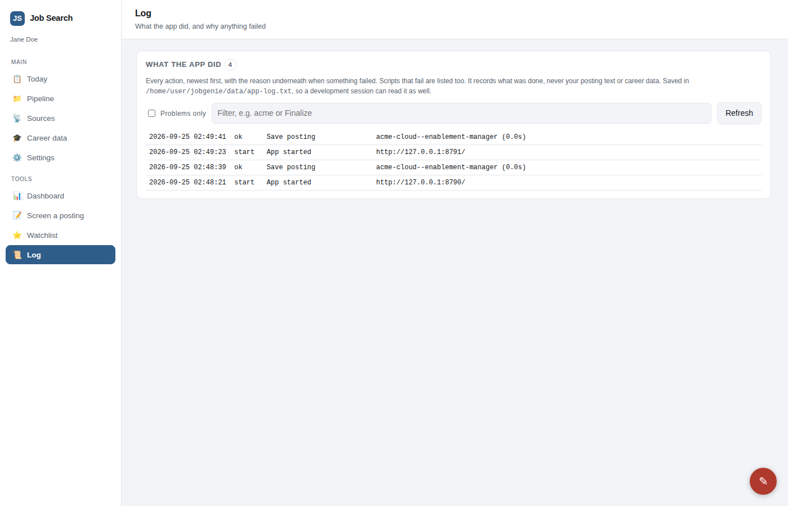

# JobGenie

[](https://github.com/ProsePixie/JobGenie/actions/workflows/tests.yml)

A local job-search system run with [Claude Code](https://claude.com/claude-code). You keep
your career as structured data. JobGenie finds and screens postings, says how qualified you
are for each one, builds a tailored CV and cover letter, checks them the way an applicant
tracking system reads them, and packages what you send. It will not invent a single claim.

Built during a real job search, for one: every feature exists because an application
went wrong without it.

## Why this is different

This is not a prompt wrapper around a chatbot. Your career facts live as structured,
traceable data, and every document is rendered from them; when Claude drafts a letter, it
works in a sandbox and can only use what your data supports. Every CV is then checked the
way an applicant-tracking system reads it, and nothing is packaged until it passes. The
deeper reasoning is under [Why it exists](#why-it-exists) and in
[How it works](docs/HOW-IT-WORKS.md).

**[Architecture](docs/ARCHITECTURE.md)** · **[Setup guide](docs/SETUP.md)** ·
**[Contributing](CONTRIBUTING.md)** · **[Sample CV](docs/sample/Jane_Doe_CV.pdf)**

> Status: complete and tested on the fictional example profile: guided onboarding from
> your own CV (`/setup`), scoring, building, checking and packaging. It runs locally on
> Windows, macOS and Linux, configured for your location and languages. See the
> [ROADMAP](ROADMAP.md) for what is next.



## Why it exists

Most "AI CV" tools rewrite you until you sound like the posting. That gets interviews you
cannot survive. JobGenie is built the other way round:

1. **Nothing is invented.** Every line on a CV or letter traces to your own data or to
   something you confirmed. A requirement you do not meet is left out or stated plainly,
   never papered over. Every change to your data is recorded with its source.
2. **One angle per application.** A CV is built from a base (professional or service) and
   *threads* - your positioning tracks, such as enablement or AI - dialed Lead, Strong,
   Light or Off. Exactly one leads.
3. **Postings are untrusted.** Every posting is screened for hidden text aimed at AI
   ("ignore previous instructions...") before anything reads it. AI sessions run with no
   file-write, web or private-data access; the calling script decides what is saved.
4. **Private stays private.** `profile/private/` (salary history, references) never enters
   a prompt. A leak check scans every package before it can be sent.

## What it does

| | |
|---|---|
| **Pipeline board** | Every opportunity as a card, found to interviewing, all on one screen; finished CVs move to Drafted on their own; closed ones go to a one-line Archive kept for learning; a readable log of what the app did |
| **Qualification score** | 0-100 per posting, computed in the background for every card (postings are fetched from each card's link), every point explained: requirements covered, in your data, or a gap |
| **Build panel** | Suggested base and threads with reasons, every bullet tickable, live preview, requirement coverage |
| **Checks** | Text layer, page count, chronology, substance, banned phrases, unsupported claims |
| **Letters** | Drafted by Claude from what your data supports, then checked the same way |
| **Package** | Separate named files (`Jane_Doe_CV.pdf`, `Jane_Doe_Cover_Letter.pdf`), refused if any check fails; one merged PDF on request for single-upload portals |
| **Scout** | Polls company job boards (Greenhouse, Lever, Ashby and others) for matching roles |
| **Skills** | `/fit`, `/apply`, `/scout`, `/warm`, `/prep`, `/outcome`, `/evidence` inside Claude Code |

## See it

Three things worth noticing: the score shows its working line by line instead of being a
mysterious number; the Build panel exposes the positioning it chose (which thread leads)
and which evidence it selected; and the sample CV is the actual final artifact, as an
applicant-tracking system would receive it.

Every posting gets a score with its reasons, including the gaps:



The Build panel: threads dialed Lead to Off, each requirement marked covered or a gap, every bullet tickable, a live preview.



A sample output, built from the fictional example profile: [Jane_Doe_CV.pdf](docs/sample/Jane_Doe_CV.pdf)



And a readable log of everything the app did:



## Quick start

Needs Python 3.10+, Chrome or Edge, and poppler (`pdftotext`; `pdfunite` only for a merged PDF). No pip installs.
On Windows, use `py` wherever this page says `python3`.

**Path 1: try the fictional example profile** (safe for a demo; no personal data)

```bash
git clone https://github.com/ProsePixie/JobGenie && cd JobGenie
./setup.sh                             # Windows: setup.bat
python3 web/server.py                  # opens the app at http://127.0.0.1:8777
```

The helper checks your tools and copies the fictional Jane Doe to `profile/` if you have
no profile yet. It never overwrites an existing profile and installs nothing. Without
it, the same thing by hand:

```bash
python3 tools/doctor.py                # checks Chrome, poppler and Python, says how to fix
cp -r profile.example profile          # the fictional Jane Doe
python3 web/server.py
```

**Path 2: create your own profile** (needs [Claude Code](https://claude.com/claude-code))

1. Start from a blank profile: `python3 tools/new_profile.py` (if you tried Jane Doe
   first, rename or remove `profile/` before this).
2. Put your CV (PDF or DOCX) in `inbox/`.
3. Open the folder in Claude Code and type **`/setup`**. It proposes each fact from your
   CV and writes only what you confirm.

Full guide: [docs/SETUP.md](docs/SETUP.md).

## Testing

```bash
python3 -m unittest discover tests -v  # fast regression tests; Python only
python3 render/render.py --check       # validates the data in profile/
python3 tools/smoke_test.py            # builds and ATS-checks a CV per thread; needs Chrome/Edge and pdftotext
```

The [regression tests](tests/) need only Python (with a profile in place, for example the
fictional one). The smoke test renders real PDFs, so it needs Chrome or Edge and poppler.
The web UI is checked by hand in a browser, and the AI steps (`/setup`, letter drafting,
fit analysis) need Claude Code. CI runs the regression tests and renders and checks a real
CV on every push.

## How it fits together

```
profile/career.json  ─┐                         ┌─> cv.pdf / cv.txt / cv.fields.json
profile/threads.json ─┼─> render/cv_builder.py ─┤
posting.txt ──screen──┘      (base + dials)     └─> render/ats_check.py ──> tools/package.py
     │
     └─> tools/qualify.py (score)   tools/draft_letter.py (Claude, sandboxed) ─> render/letter.py
web/server.py: local UI over all of it (127.0.0.1 only, stdlib only)
```

The **[architecture document](docs/ARCHITECTURE.md)** covers the safety boundaries, the
rendering and verification pipeline, and how the web UI delegates to these same scripts.
**[How it works, and why it is built this way](docs/HOW-IT-WORKS.md)** explains the design
decisions. `CLAUDE.md` holds the rules every Claude Code session follows in this repo.

## Limits, stated plainly

- The AI steps (letter drafting, fit analysis, `/setup`) need Claude Code on your machine.
  Building, checking, scoring and packaging do not.
- PDFs need Chrome or Edge and poppler.
- The score matches words, not meaning: it is reliable for spotting gaps and what a CV
  leaves out, less so on short or generic postings. Every line of it is shown so you can judge.
- CVs in English and German today.
- The example profile (Jane Doe) is fictional. Your own data lives only in `profile/`,
  which is gitignored.
- It is a local-first tool, not a hosted service: nothing runs on a server you do not
  control.

## Contributing

See [CONTRIBUTING.md](CONTRIBUTING.md): how to set up, run the checks, and keep real
personal data out of issues, pull requests and commits.

## License

MIT, see [LICENSE](LICENSE).

## Credits

The drafter/reviewer split, grounding audit, backtrack test and ATS text-layer check borrow
from [MadsLorentzen/ai-job-search](https://github.com/MadsLorentzen/ai-job-search) (MIT).
