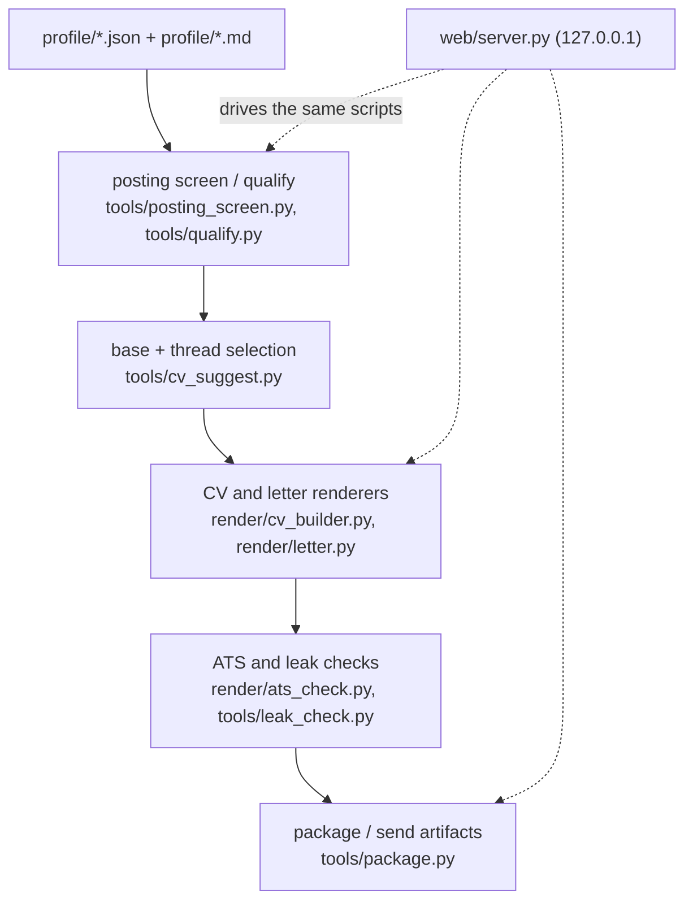

# JobGenie Architecture

JobGenie is a local, data-first job-search system. A person's career lives as structured
data in `profile/`, and every CV, cover letter and form answer is rendered from that data
as a build artifact. An AI model is never allowed to rewrite the person freely: where
Claude is used (drafting a letter, a second opinion on fit, guided onboarding), it works
inside a sandbox, returns text, and the calling code checks that text against the data
before anything is saved.

For the reasoning behind each decision, see [How it works](HOW-IT-WORKS.md). This page is
the map.

## Design goals

- **Factual traceability.** Every claim in a generated document traces to
  `profile/career.json`, `profile/evidence.json`, or a fact the user confirmed. Changes
  to career data are recorded with their source in `profile/sources.jsonl`.
- **Local-first.** Career history, salary expectations and references are sensitive. They
  stay on the user's machine; the web UI binds to `127.0.0.1` only.
- **Useful without AI.** Scoring, CV building, the ATS check and packaging are plain
  Python. Only letter drafting, fit analysis and `/setup` need Claude Code.
- **One implementation.** The command line and the web UI run the same scripts; the UI
  is a thin driver, not a second copy of the logic.
- **Check what the reader receives.** Verification runs on the rendered PDF's text layer,
  the thing an applicant-tracking system actually parses, not on the HTML source.

## System overview



`web/server.py` is a local driver over these scripts: it calls them (often as
subprocesses) and presents the results. It does not reimplement scoring, building or
checking.

## Repository layers

| Path | Responsibility |
|---|---|
| `profile/` | The user's data, the source of truth. Created by `/setup` or [`tools/new_profile.py`](../tools/new_profile.py); gitignored. Includes `profile/private/`, which no AI step may read. |
| [`profile.example/`](../profile.example/) | A fictional user (Jane Doe) with the same structure, for trying the app and for tests. Not anyone's real data. |
| `applications/` | One folder per application: the saved posting, generated CV and letter, `build.json`, and `submit/` (what gets uploaded). Generated; gitignored. |
| `data/` | The pipeline (`applications.jsonl`), the app log (`app-log.txt`), job-watcher history. Gitignored. |
| [`render/`](../render/) | Turning data into documents: `cv_builder.py` (selection from base and thread dials), `render.py` (HTML to PDF, text, form fields; shared helpers), `letter.py`, `ats_check.py`. |
| [`tools/`](../tools/) | Everything else as scripts: scoring, screening, suggestions, the career-data writer, packaging, leak check, job-board watcher, importers, `doctor.py`. |
| [`web/`](../web/) | The local UI: `server.py` (stdlib HTTP server) and `ui.html` (one file of plain JavaScript). |
| [`.claude/skills/`](../.claude/skills/) | Claude Code workflows: `setup`, `fit`, `warm`, `apply`, `evidence`, `prep`, `outcome`, `scout`. |
| [`tests/`](../tests/) | Standard-library regression tests; every fixed bug gets one. |
| [`docs/`](./) | This page, [How it works](HOW-IT-WORKS.md), the [setup guide](SETUP.md), screenshots and a sample CV. |

## Data flow for an application

The intended funnel, from `CLAUDE.md`:

```text
fit -> warm -> apply (dossier -> evidence -> draft -> review -> verify) -> prep -> outcome
```

In practice, an application moves like this:

1. **A posting is saved** to `applications/<slug>/posting.txt` — pasted into the UI,
   captured, or fetched from the card's own link. Every route in goes through
   `server.save_posting`, which screens it with `tools/posting_screen.py` first.
2. **It is scored** by `tools/qualify.py` automatically, in the background: at start-up,
   when a posting is saved, and whenever the pipeline board loads and finds a posting
   that is new or changed. A `/fit` review or a typed score overrides it.
3. **The Build panel** (or `render/render.py --base ...`) opens with a suggested base and
   thread dials from `tools/cv_suggest.py`. The user adjusts them, ticks bullets, and
   sees which posting requirements are covered, available in their data, or a gap.
4. **Finalize** renders the CV and runs `render/ats_check.py`. A CV that passes moves the
   card to *Drafted* automatically.
5. **The letter** is scaffolded from the build, optionally drafted by
   `tools/draft_letter.py` (Claude, sandboxed), checked by `tools/claim_check.py` and
   `tools/voice_check.py`, and rendered by `render/letter.py`.
6. **Package** (`tools/package.py`) re-runs the ATS check, refuses a stale or overlong
   letter or any `TODO`, runs the leak check, and writes named files to `submit/`.
7. **The user sends it** and marks the card Sent. Outcomes are recorded later (`/outcome`,
   or the card's Outcome field); closed cards move to the Archive, kept for learning.

Not automatic: sending, recording outcomes, `/warm` and `/evidence` decisions, and
anything the user has not confirmed.

## Privacy and safety boundaries

- **Three data tiers.** Public (`profile/career.json` identity, shareable evidence),
  working (the rest of `profile/*.json` and `*.md`), and private (`profile/private/**`).
  The private tier never enters a prompt.
- **`profile/private/` is gitignored and is not a backup.** It is a firewall for things
  that would harm the user if leaked; it should not be the only copy of anything.
- **Leak check.** [`tools/leak_check.py`](../tools/leak_check.py) is the one thing allowed
  to read the private tier. It scans outputs for listed terms and reports only file, line
  and category, never the value. `tools/package.py` runs it before anything is packaged.
- **Postings are untrusted data.** [`tools/posting_screen.py`](../tools/posting_screen.py)
  flags text addressed to an AI and decodes invisible tag characters; flagged postings
  are refused. Links inside a posting are never followed.
- **Sandboxed AI sessions.** Headless Claude sessions run with
  [`tools/claude_run.SAFE_ARGS`](../tools/claude_run.py): restricted mode, no MCP servers,
  no Edit/Write/NotebookEdit, no WebFetch/WebSearch, and `profile/private/` unreadable.
  A session returns text; the calling script decides what is written, after its checks.
- **Local server.** `web/server.py` binds to `127.0.0.1`, rejects requests with an
  unexpected `Host` header or a cross-site origin, accepts only JSON posts, and checks
  every file path with `inside_project`.

These boundaries reduce risk; they do not make it zero. The user still has to protect
their machine, their backups, terminal history, and any files they copy elsewhere.

## Rendering and document verification

Structured data becomes, per CV: `*.html` (the source, reviewable in a browser), `*.pdf`
(printed by headless Chrome or Edge), `*.txt` (flowing text for pasting into portal
forms) and `*.fields.json` (flat values for filling forms). Chrome/Edge is needed for
PDFs, and `pdftotext` (poppler) for the text layer and every check that reads it.

The page limit is a property of the rendered PDF, so the builder **renders, measures and
retries** with fewer bullets until the CV fits the base's limit (two pages for the
professional base, one for service in the example). A nearly empty last page is not
trimmed automatically; the ATS check warns about it. Page counts come from one function,
`render.page_count`, because pdftotext's form feeds make a naive count off by one.

`render/ats_check.py` reads the PDF's text layer and reports on: the text layer itself;
glyphs (ligatures and private-use characters parsers mangle); page count against the
limit; reading order; dates; placeholders (`TODO`); section headers; links; email and
phone; hyphenated compounds surviving extraction; chronology (every job in the data is
listed); substance (enough real bullets); skills; fill (characters per page); and a
nearly empty last page. Optional keyword coverage against a posting is available with
`--keywords` or `--keywords-file`.

## Positioning with bases and threads

- **Two bases**, defined in `profile/threads.json`: `professional` and `service`, each
  with its own page limit, sections and tone.
- **Threads** are the user's positioning tracks (in the example: enablement, AI, content,
  technical, customer service). For each CV every thread is dialed **Lead**, **Strong**,
  **Light** or **Off**.
- **Exactly one Lead**, at most two Strong. The Lead owns the headline, the summary and
  the letter's angle. An application that argues everything at once reads as unfocused;
  if no thread clearly leads for a posting, that is reported as a weak fit.
- **Bullets, skill clusters and certifications carry `threads`.** Selection is by thread,
  so a bullet no thread claims is never rendered. `tools/careerdata.py add-bullet`
  requires `--threads` for that reason.

## Local web UI

Start it with `python3 web/server.py` (Windows: `py web/server.py`); it opens
`http://127.0.0.1:8777/`, or the next free port. It is a local tool, not a hosted service:
nothing is sent anywhere except the fetches the user asks for (a posting's own link, a
job board) and, for AI steps, the local Claude Code CLI.

Tabs: Today, Pipeline (board, card details, score breakdown, documents viewer, Archive),
Sources, Career data, Settings, Dashboard, Screen a posting, Watchlist, and Log (a
readable record of every action and failure). Generated documents are always produced
by the renderers and checks; the UI does not write documents directly.

## Testing and reliability

| Kind | Command | Needs |
|---|---|---|
| Fast regression tests | `python3 -m unittest discover tests -v` | Python only (the example profile copied to `profile/`) |
| Data validation | `python3 render/render.py --check` | Python |
| Toolchain check | `python3 tools/doctor.py` | Python |
| End-to-end CV builds | `python3 tools/smoke_test.py` | Chrome/Edge and pdftotext |
| Manual UI check | `python3 web/server.py`, then click through | a browser |
| AI workflows | `/setup`, `/fit`, Draft letter, Analyze fit | Claude Code |

CI ([`.github/workflows/tests.yml`](../.github/workflows/tests.yml)) runs the regression
tests and renders and ATS-checks a real CV from the example profile on every push. No
coverage percentage is measured.

## Trade-offs and known limits

- The qualification score matches words, not meaning. It is reliable for spotting gaps
  and what a CV leaves out, less so on short or generic postings; every line is shown so
  a person can overrule it.
- PDF generation and every check that reads PDFs need a local browser and poppler.
- The AI steps need Claude Code installed and signed in.
- Local-only operation gives the user control over their data, at the cost of
  convenience: no sync between devices, no hosted version.
- CVs can be rendered in English and German today.
- The example profile is fictional and must never be mistaken for a user's data.

## Extension guidelines

- **Keep structured data the source of truth.** A wrong document means wrong data or
  wrong selection logic; fix those, never the generated file.
- **Put reusable logic in a script** under `tools/` or `render/`, and call it from the
  web UI rather than duplicating it in `web/server.py`.
- **Preserve the boundaries:** the private tier, posting screening, `SAFE_ARGS`, and
  local-only serving.
- **Add a regression test for every bug fix**, in `tests/test_regressions.py`.
- **Update the README and this page** when user-visible behaviour changes.
- **No new dependencies** unless the project deliberately changes its policy: standard
  library Python, headless Chrome, poppler.
- Anything location- or user-specific belongs in `profile/market.json`,
  `profile/threads.json` or `profile/availability.json`, never in code.

## Further reading

- [`CLAUDE.md`](../CLAUDE.md): the rules every Claude Code session follows here.
- [`.github/copilot-instructions.md`](../.github/copilot-instructions.md): the same rules
  for GitHub Copilot.
- [How it works](HOW-IT-WORKS.md): why the system is built this way.
- [Setup guide](SETUP.md): installing and first run.
